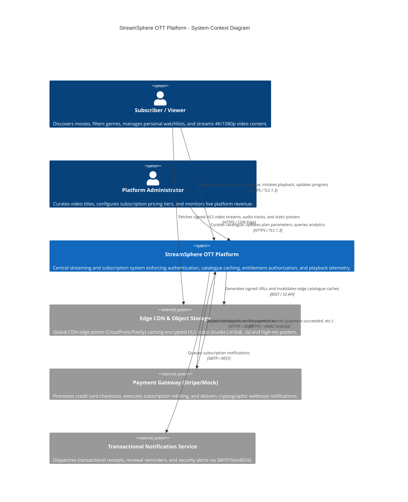
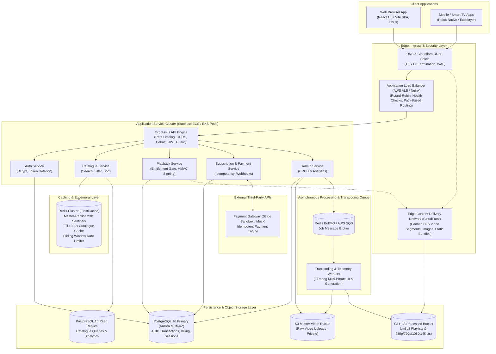

# StreamSphere — High-Level Design (HLD)

## 1. Executive Summary & System Objectives

**StreamSphere** is an enterprise-grade Video-on-Demand (VOD) and subscription streaming platform built for high-concurrency catalogue browsing, low-latency playback authorization, multi-bitrate media streaming (HLS/DASH), and idempotent subscription billing.

The system is engineered according to modern distributed systems standards:
- **Stateless Micro-Modular API Core**: Node.js, Express, TypeScript.
- **Relational Integrity**: PostgreSQL 16 managed via Prisma ORM for ACID compliance across billing, entitlements, and user sessions.
- **High-Throughput Caching**: Redis primary with an in-memory TTL resilient fallback driver.
- **Content Delivery & Protection**: Edge CDN distribution with short-lived HMAC-SHA256 signed playback tokens.
- **Zero-Trust Playback Gate**: Strict backend validation of plan tiers before issuing media stream authorizations.

---

## 2. System Context Diagram (C4 Level 1)

The following C4 Context diagram illustrates how viewers, administrators, edge CDNs, and third-party payment providers interact with the StreamSphere boundary:

---

## 3. Scalable Target Architecture Diagram (C4 Level 2)

The production-ready architecture decouples read-heavy browsing, CPU-heavy media ingestion, and mission-critical financial processing:

---

## 4. Key Architectural Components

### 4.1 Ingress, API Gateway & Load Balancing
- **Application Load Balancer (ALB)**: Distributes inbound HTTPS traffic across identical stateless Express container pods using least-outstanding-requests routing.
- **Path-Based Routing**:
  - `/api/media/stream/*`: High-bandwidth proxy endpoint (signed token verification).
  - `/api/videos*`, `/api/genres*`: Read-intensive catalogue routes (served from Redis).
  - `/api/auth/*`, `/api/subscriptions/*`: High-security transactional endpoints.
- **Security Middlewares**:
  - `Helmet`: Sets HTTP security headers (HSTS, CSP, X-Frame-Options).
  - `CORS`: Restricts origins strictly to configured frontend web origins.
  - `Rate Limiter`: Sliding-window in-memory/Redis rate limiting (e.g., 50 auth requests / 15 mins).

### 4.2 Application Services Layer
- **Stateless Operation**: Application nodes store zero local state or in-memory session tokens. User authentication relies on short-lived JWT access tokens (15 minutes) and cryptographically hashed refresh tokens stored in PostgreSQL.
- **Zod Validation Pipeline**: Every incoming HTTP request body and query string is parsed and validated before reaching controller business logic.
- **Centralized Error Handling**: Custom `AppError` taxonomy maps internal exceptions directly to sanitized client responses (e.g., 400 Validation Error, 401 Unauthorized, 403 Upgrade Required, 404 Not Found, 409 Conflict).

### 4.3 Database Architecture (PostgreSQL 16 & Prisma ORM)
- **Primary-Replica Segregation**:
  - **Write Primary**: Processes checkouts, user registrations, watchlist modifications, and playback heartbeats.
  - **Read Replica**: Offloads high-frequency catalogue listing, category aggregation, and admin analytics queries.
- **Connection Pooling**: Managed via Prisma client pooling (`connection_limit=20` per instance) to eliminate database socket exhaustion under load spikes.
- **Transaction Safety**: Financial actions (deactivating prior subscriptions + activating new tier + recording payment) run inside `prisma.$transaction()` to guarantee complete atomicity.

### 4.4 Caching Strategy (Redis & Dual-Mode Driver)
- **TTL Cache**: Catalogue listing (`catalogue:videos:p1:l20:...`) and genre aggregations are cached with a 300-second (5 minute) TTL.
- **Write-Through Invalidation**: Mutations performed by administrators (creating, modifying, or deleting video titles) execute `cache.flush()`, immediately purging stale caches.
- **Dual-Driver Fallback**: If Redis becomes temporarily unreachable, the caching module gracefully defaults to an in-memory TTL map (`MemoryCacheDriver`), preventing application crashes.

### 4.5 Media Storage, Transcoding Pipeline & CDN
- **Master Ingestion Bucket**: Administrators upload raw video masters (`.mp4`, `.mov`) to a private S3 storage bucket.
- **Asynchronous Transcoding (FFmpeg / AWS MediaConvert)**:
  - Generates multi-bitrate HLS renditions: 480p (800 kbps), 720p (2500 kbps), 1080p (5000 kbps), and 4K UHD (15000 kbps).
  - Segments audio and video into 6-second `.ts` chunks referenced by a master `.m3u8` playlist.
- **Edge CDN Delivery**: Video segments are distributed globally via CDN edge points. Edge requests for media verify short-lived HMAC-SHA256 playback tokens.

### 4.6 Payment Gateway & Idempotent Processing
- **Idempotency Protection**: Checkouts accept a client-generated `idempotencyKey` indexed uniquely in the `Payment` table. Duplicate submissions replay the initial transaction without re-charging the card.
- **Webhook Signature Verification**: Webhook callbacks verify `x-webhook-signature` using HMAC-SHA256 and constant-time buffer comparison (`crypto.timingSafeEqual`) to prevent replay and timing attacks.

---

## 5. Non-Functional System Requirements & Solutions

| Pillar | Architectural Strategy | Implementation in StreamSphere |
|---|---|---|
| **Horizontal Scalability** | Stateless service containerization behind ALB | Express pods scale from 2 to 20 instances based on CPU utilization > 70%. |
| **High Availability** | Multi-AZ deployment with active read replicas | PostgreSQL deployed across 2 Availability Zones; Redis Sentinels handle automated failover. |
| **Data Consistency** | Relational ACID guarantees for billing; Eventual consistency for telemetry | Financial states commit synchronously in transactions; Viewing counts update asynchronously. |
| **Fault Tolerance** | Graceful degradation and fallback mechanisms | In-memory cache fallback when Redis is offline; Direct video fallback when HLS manifest is absent. |
| **Low Latency Playback** | Edge CDN caching for video segments | 95%+ of video chunk requests served directly from edge POPs within 20ms of viewer. |
| **Security & Privacy** | OWASP Top 10 compliance & tokenized media gating | Bcrypt (cost 12), HttpOnly refresh cookies, CSRF protection, signed media tokens, parameterized Prisma queries. |

---

## 6. Implementation Status vs. Production Roadmap

To provide complete transparency between the tested codebase and target production infrastructure:

```mermaid
graph LR
    subgraph ImplementedLocally ["Verified in Current Codebase"]
        L1["Express API Engine & Zod Schemas"]
        L2["PostgreSQL Schema & Prisma Migrations"]
        L3["JWT Auth & Refresh Token Lifecycle"]
        L4["In-Memory TTL Cache Fallback Driver"]
        L5["Idempotent Payment Sandbox & Webhook HMAC"]
        L6["Signed Media Token Generation (HMAC-SHA256)"]
        L7["Custom HTML5 / HLS.js Video Player"]
        L8["Watchlist & Playback Progress Persistence"]
        L9["Admin Video & Pricing Management"]
    end

    subgraph TargetProduction ["Production Cloud Infrastructure"]
        P1["AWS CloudFront Global CDN Edge"]
        P2["AWS S3 Private Media Buckets"]
        P3["AWS Elemental MediaConvert (Automated HLS)"]
        P4["AWS ElastiCache Redis Cluster (Multi-AZ)"]
        P5["Amazon Aurora PostgreSQL Multi-AZ Cluster"]
        P6["Stripe Production Webhook Integration"]
        P7["AWS WAF & Cloudflare DDoS Shield"]
    end

    ImplementedLocally -.->|Deploy to| TargetProduction
```

| Component | Implemented in Workspace | Target Production Cloud Infrastructure |
|---|---|---|
| **API Server** | Node.js 20 / Express / TypeScript running on port 5000 | Containerized Docker image on AWS ECS Fargate or EKS Kubernetes cluster. |
| **Database** | PostgreSQL 16 on `localhost:5432` with 9 Prisma relational tables | AWS Aurora Serverless v2 PostgreSQL (Multi-AZ, Read Replica auto-scaling). |
| **Cache Layer** | Active In-Memory TTL Cache with fully wired Redis client driver | AWS ElastiCache for Redis Cluster (Multi-AZ, Cluster Mode enabled). |
| **Media Delivery** | Token-protected proxy streaming with public sample fallback | Amazon CloudFront distribution fronting private S3 bucket with Origin Access Control (OAC). |
| **Transcoding** | Pre-seeded multi-format sample media files | AWS S3 Event Trigger -> SQS -> AWS Elemental MediaConvert / FFmpeg worker. |
| **Payment Gateway** | Deterministic Sandbox Simulator (Visa, Mastercard, Decline test codes) | Stripe Production API with customer vaulting, Stripe Elements, and recurring webhook dispatch. |
