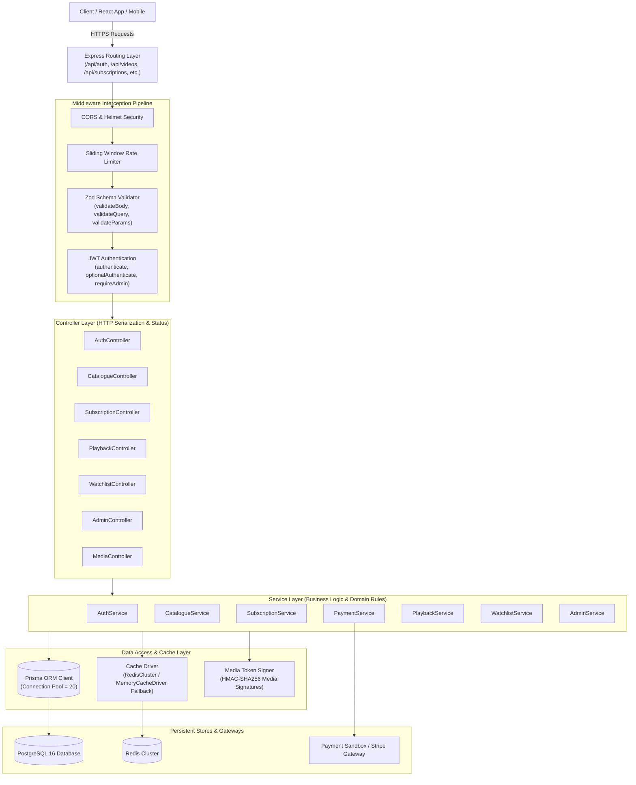
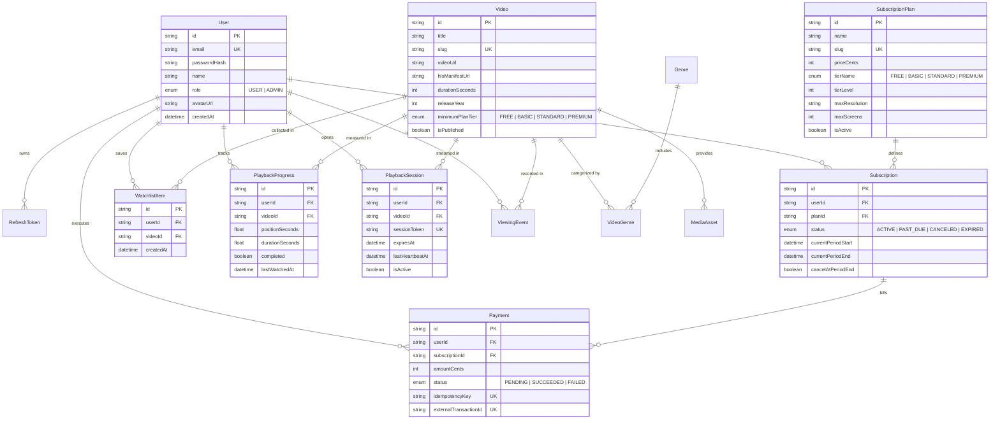
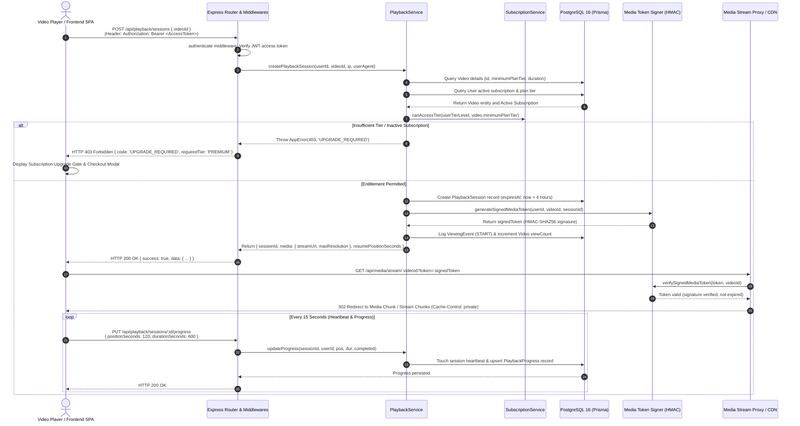
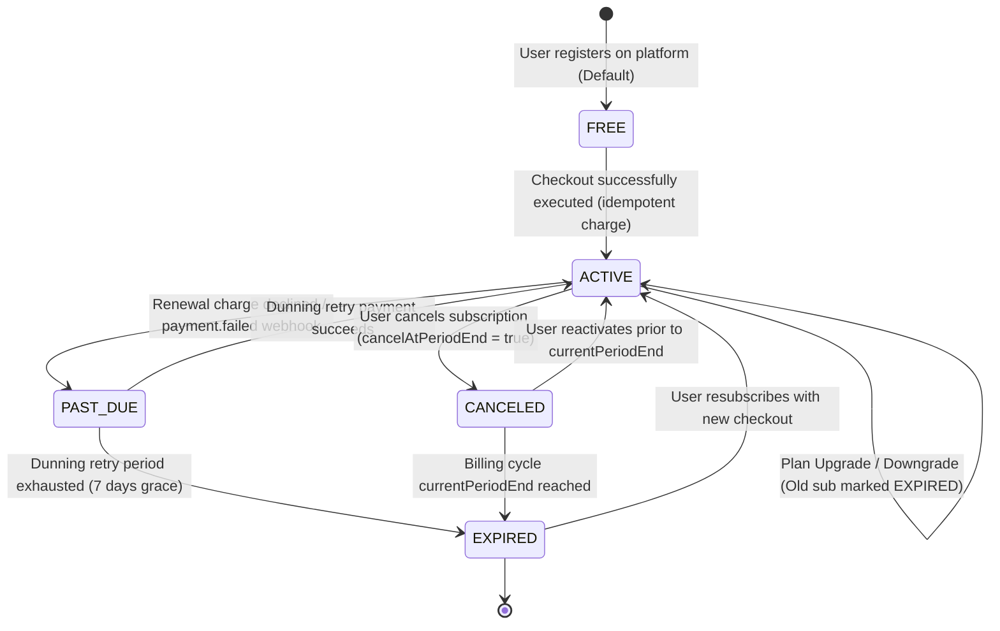

# StreamSphere — Low-Level Design (LLD)

## 1. Low-Level Architecture & Component Model

The StreamSphere backend strictly implements the **Controller-Service-Repository** architectural pattern with clear layer decoupling:



---

## 2. UML Class Diagram & Domain Entities

The diagram below maps the actual implemented TypeScript classes, methods, and Prisma data models with precise attributes, return types, and relational multiplicities:

```mermaid
classDiagram
    direction TB

    class AuthController {
        +register(req: Request, res: Response, next: NextFunction): Promise~void~
        +login(req: Request, res: Response, next: NextFunction): Promise~void~
        +refresh(req: Request, res: Response, next: NextFunction): Promise~void~
        +logout(req: Request, res: Response, next: NextFunction): Promise~void~
        +getMe(req: Request, res: Response, next: NextFunction): Promise~void~
        +updateProfile(req: Request, res: Response, next: NextFunction): Promise~void~
    }

    class CatalogueController {
        +listVideos(req: Request, res: Response, next: NextFunction): Promise~void~
        +getVideo(req: Request, res: Response, next: NextFunction): Promise~void~
        +getGenres(req: Request, res: Response, next: NextFunction): Promise~void~
    }

    class SubscriptionController {
        +getPlans(req: Request, res: Response, next: NextFunction): Promise~void~
        +getMySubscription(req: Request, res: Response, next: NextFunction): Promise~void~
        +checkout(req: Request, res: Response, next: NextFunction): Promise~void~
        +cancel(req: Request, res: Response, next: NextFunction): Promise~void~
        +getPayments(req: Request, res: Response, next: NextFunction): Promise~void~
        +handleWebhook(req: Request, res: Response, next: NextFunction): Promise~void~
    }

    class PlaybackController {
        +createSession(req: Request, res: Response, next: NextFunction): Promise~void~
        +updateProgress(req: Request, res: Response, next: NextFunction): Promise~void~
        +getResume(req: Request, res: Response, next: NextFunction): Promise~void~
        +getContinueWatching(req: Request, res: Response, next: NextFunction): Promise~void~
    }

    class WatchlistController {
        +getWatchlist(req: Request, res: Response, next: NextFunction): Promise~void~
        +add(req: Request, res: Response, next: NextFunction): Promise~void~
        +remove(req: Request, res: Response, next: NextFunction): Promise~void~
    }

    class AdminController {
        +getAnalytics(req: Request, res: Response, next: NextFunction): Promise~void~
        +createVideo(req: Request, res: Response, next: NextFunction): Promise~void~
        +updateVideo(req: Request, res: Response, next: NextFunction): Promise~void~
        +deleteVideo(req: Request, res: Response, next: NextFunction): Promise~void~
        +updatePlan(req: Request, res: Response, next: NextFunction): Promise~void~
    }

    class AuthService {
        +register(data: RegisterDTO): Promise~AuthResult~
        +login(data: LoginDTO): Promise~AuthResult~
        +refreshTokens(refreshToken: string): Promise~TokenPair~
        +revokeUserTokens(userId: string): Promise~void~
        +getMe(userId: string): Promise~UserProfile~
        +updateProfile(userId: string, data: UpdateProfileDTO): Promise~UserProfile~
    }

    class CatalogueService {
        +getGenres(): Promise~Genre[]~
        +listVideos(options: FilterOptions, userId?: string): Promise~VideoListResponse~
        +getVideoById(idOrSlug: string, userId?: string): Promise~VideoDetails~
        -augmentVideosWithUserData(response: any, userId: string): Promise~any~
    }

    class SubscriptionService {
        +getPlans(): Promise~SubscriptionPlanDTO[]~
        +getUserActiveSubscription(userId: string): Promise~UserEntitlement~
        +cancelSubscription(userId: string, subscriptionId: string): Promise~CancelResult~
        +canAccessTier(userTierLevel: number, requiredTier: PlanTier): boolean
    }

    class PaymentService {
        +processCheckout(options: CheckoutOptions): Promise~CheckoutResult~
        +handleWebhook(signature: string, payload: any, rawBody: string): Promise~WebhookResult~
        +getPaymentHistory(userId: string): Promise~Payment[]~
    }

    class PlaybackService {
        +createPlaybackSession(userId: string, videoId: string, ip?: string, ua?: string): Promise~PlaybackSessionResult~
        +updateProgress(sessionId: string, userId: string, pos: number, dur: number, completed?: boolean): Promise~PlaybackProgress~
        +getResume(userId: string, videoId: string): Promise~PlaybackProgress~
        +getContinueWatching(userId: string): Promise~ContinueWatchingItem[]~
    }

    class AdminService {
        +getAnalytics(): Promise~AdminAnalytics~
        +createVideo(data: CreateVideoDTO): Promise~Video~
        +updateVideo(id: string, data: UpdateVideoDTO): Promise~Video~
        +deleteVideo(id: string): Promise~DeleteResult~
        +updatePlan(id: string, data: UpdatePlanDTO): Promise~SubscriptionPlan~
    }

    class User {
        +string id
        +string email
        +string passwordHash
        +string name
        +Role role
        +string avatarUrl
        +DateTime createdAt
        +DateTime updatedAt
    }

    class SubscriptionPlan {
        +string id
        +string name
        +string slug
        +string description
        +int priceCents
        +string currency
        +PlanInterval billingInterval
        +string maxResolution
        +int maxScreens
        +int tierLevel
        +PlanTier tierName
        +string features
        +boolean isActive
    }

    class Subscription {
        +string id
        +string userId
        +string planId
        +SubscriptionStatus status
        +DateTime currentPeriodStart
        +DateTime currentPeriodEnd
        +boolean cancelAtPeriodEnd
    }

    class Payment {
        +string id
        +string userId
        +string subscriptionId
        +int amountCents
        +string currency
        +PaymentStatus status
        +string paymentMethod
        +string idempotencyKey
        +string externalTransactionId
        +string failureReason
    }

    class Video {
        +string id
        +string title
        +string slug
        +string description
        +string posterUrl
        +string thumbnailUrl
        +string videoUrl
        +string hlsManifestUrl
        +int durationSeconds
        +int releaseYear
        +string maturityRating
        +float rating
        +boolean isFeatured
        +boolean isTrending
        +int viewCount
        +PlanTier minimumPlanTier
        +boolean isPublished
    }

    class PlaybackProgress {
        +string id
        +string userId
        +string videoId
        +float positionSeconds
        +float durationSeconds
        +boolean completed
        +DateTime lastWatchedAt
    }

    class PlaybackSession {
        +string id
        +string userId
        +string videoId
        +string sessionToken
        +string ipAddress
        +string userAgent
        +DateTime expiresAt
        +DateTime lastHeartbeatAt
        +boolean isActive
    }

    class WatchlistItem {
        +string id
        +string userId
        +string videoId
        +DateTime createdAt
    }

    %% Multiplicities & Relationships
    AuthController --> AuthService
    CatalogueController --> CatalogueService
    SubscriptionController --> SubscriptionService
    SubscriptionController --> PaymentService
    PlaybackController --> PlaybackService
    WatchlistController --> WatchlistService
    AdminController --> AdminService

    User "1" --> "0..*" Subscription : "subscribes"
    User "1" --> "0..*" Payment : "pays"
    User "1" --> "0..*" WatchlistItem : "bookmarks"
    User "1" --> "0..*" PlaybackProgress : "tracks"
    User "1" --> "0..*" PlaybackSession : "streams"

    SubscriptionPlan "1" --> "0..*" Subscription : "defines"
    Subscription "1" --> "0..*" Payment : "bills"

    Video "1" --> "0..*" WatchlistItem : "collected in"
    Video "1" --> "0..*" PlaybackProgress : "watched in"
    Video "1" --> "0..*" PlaybackSession : "session for"
```



---

## 3. Database Schema & Entity Relational Model

The relational database architecture is defined in [schema.prisma](file:///c:/Users/indhu/system-design/backend/prisma/schema.prisma) and enforced with PostgreSQL constraints:



---

## 4. Playback Authorization Sequence Diagram



---

## 5. Subscription Lifecycle State Machine

The subscription status transition model prevents invalid financial states:



---

## 6. REST API Specification

### 6.1 Authentication (`/api/auth`)

#### `POST /api/auth/register`
- **Description**: Registers a new user account and provisions a Free tier entitlement.
- **Request Body**:
```json
{
  "name": "Sarah Connor",
  "email": "sarah@streamsphere.com",
  "password": "User123!"
}
```
- **Response (201 Created)**:
```json
{
  "success": true,
  "data": {
    "user": {
      "id": "223428f1-b9a9-4580-b302-413d4797283c",
      "name": "Sarah Connor",
      "email": "sarah@streamsphere.com",
      "role": "USER",
      "entitlement": {
        "tierName": "FREE",
        "tierLevel": 0
      }
    },
    "tokens": {
      "accessToken": "eyJhbGciOiJIUzI1NiIsInR5cCI6IkpXVCJ9...",
      "refreshToken": "7c8e9b01-..."
    }
  }
}
```

#### `POST /api/auth/login`
- **Description**: Authenticates user credentials and issues tokens.
- **Status Codes**: `200 OK`, `401 Invalid Credentials`, `429 Too Many Requests`.

---

### 6.2 Video Catalogue (`/api/videos`)

#### `GET /api/videos`
- **Description**: Queries catalogue with pagination, search, genre filter, and sorting.
- **Query Parameters**:
  - `page`: Integer (default: 1)
  - `limit`: Integer (default: 20, max: 50)
  - `search`: String (optional search keyword)
  - `genre`: String (slug e.g., `sci-fi`, `action`)
  - `tier`: `FREE | BASIC | STANDARD | PREMIUM` (optional)
  - `sortBy`: `trending | rating | year | views | newest` (default: `trending`)
- **Response (200 OK)**:
```json
{
  "success": true,
  "data": {
    "videos": [
      {
        "id": "5aeb25ad-138d-49a6-9c37-0de0eab6f25c",
        "title": "Neon Samurai: Blade of Shinjuku",
        "slug": "neon-samurai",
        "description": "An augmented warrior hunts down cybernetic cartels...",
        "posterUrl": "https://images.unsplash.com/photo-1579783902614-a3fb3927b675",
        "durationSeconds": 734,
        "releaseYear": 2024,
        "rating": 9.2,
        "minimumPlanTier": "FREE",
        "genres": [
          { "id": "action-id", "name": "Action", "slug": "action" },
          { "id": "scifi-id", "name": "Sci-Fi", "slug": "sci-fi" }
        ],
        "inWatchlist": false
      }
    ],
    "pagination": {
      "page": 1,
      "limit": 20,
      "total": 24,
      "totalPages": 2
    }
  }
}
```

---

### 6.3 Playback Management (`/api/playback`)

#### `POST /api/playback/sessions`
- **Description**: Requests an authorized playback session and signed streaming token.
- **Headers**: `Authorization: Bearer <AccessToken>`
- **Request Body**:
```json
{
  "videoId": "5aeb25ad-138d-49a6-9c37-0de0eab6f25c"
}
```
- **Response (200 OK)**:
```json
{
  "success": true,
  "data": {
    "sessionId": "0e6e561c-e909-4a34-a51e-5a82c016884e",
    "video": {
      "id": "5aeb25ad-138d-49a6-9c37-0de0eab6f25c",
      "title": "Neon Samurai: Blade of Shinjuku",
      "durationSeconds": 734
    },
    "media": {
      "streamUrl": "/api/media/stream/5aeb25ad?token=eyJ1c2VySWQiOiIyMjM...",
      "directFallbackUrl": "https://commondatastorage.googleapis.com/.../TearsOfSteel.mp4",
      "maxResolution": "4K"
    },
    "resumePositionSeconds": 120
  }
}
```
- **Response (403 Forbidden — Denied)**:
```json
{
  "success": false,
  "error": "Playback denied: \"Solaris Eclipse\" requires a PREMIUM plan. Your current active tier is BASIC.",
  "code": "UPGRADE_REQUIRED",
  "details": {
    "requiredTier": "PREMIUM",
    "currentTier": "BASIC"
  }
}
```

#### `PUT /api/playback/sessions/:id/progress`
- **Description**: Heartbeat endpoint saving viewing progress and last watched timestamp.
- **Request Body**:
```json
{
  "positionSeconds": 245.5,
  "durationSeconds": 734,
  "completed": false
}
```
- **Response (200 OK)**: `{ "success": true, "data": { "positionSeconds": 245.5 } }`

---

### 6.4 Subscriptions & Billing (`/api/subscriptions`)

#### `POST /api/subscriptions/checkout`
- **Description**: Idempotent sandbox checkout for purchasing subscription tiers.
- **Headers**: `Authorization: Bearer <AccessToken>`
- **Request Body**:
```json
{
  "planId": "cd232789-f51b-491f-ae3b-3c0ee258c05a",
  "paymentMethod": "card_mock_visa",
  "idempotencyKey": "checkout_1791897751997_xyz",
  "simulateFailure": false
}
```
- **Response (200 OK)**:
```json
{
  "success": true,
  "data": {
    "success": true,
    "payment": {
      "id": "pay-uuid",
      "amountCents": 1799,
      "status": "SUCCEEDED"
    },
    "subscription": {
      "id": "sub-uuid",
      "status": "ACTIVE",
      "currentPeriodEnd": "2026-11-12T13:25:00Z"
    },
    "message": "Payment of $17.99 confirmed. Your StreamSphere Premium is now active!"
  }
}
```

#### `POST /api/subscriptions/webhook`
- **Description**: Webhook endpoint for receiving asynchronous payment events.
- **Headers**: `x-webhook-signature: <HMAC-SHA256 signature>`
- **Request Body**:
```json
{
  "event": "payment.succeeded",
  "data": {
    "subscriptionId": "sub-uuid",
    "externalTransactionId": "txn_12345"
  }
}
```
- **Response (200 OK)**: `{ "received": true, "event": "payment.succeeded" }`
